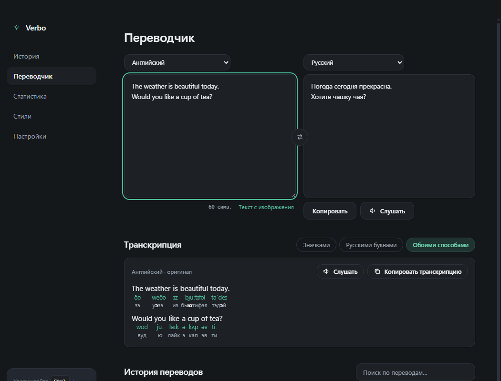
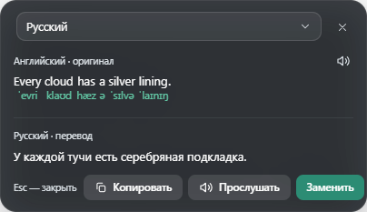
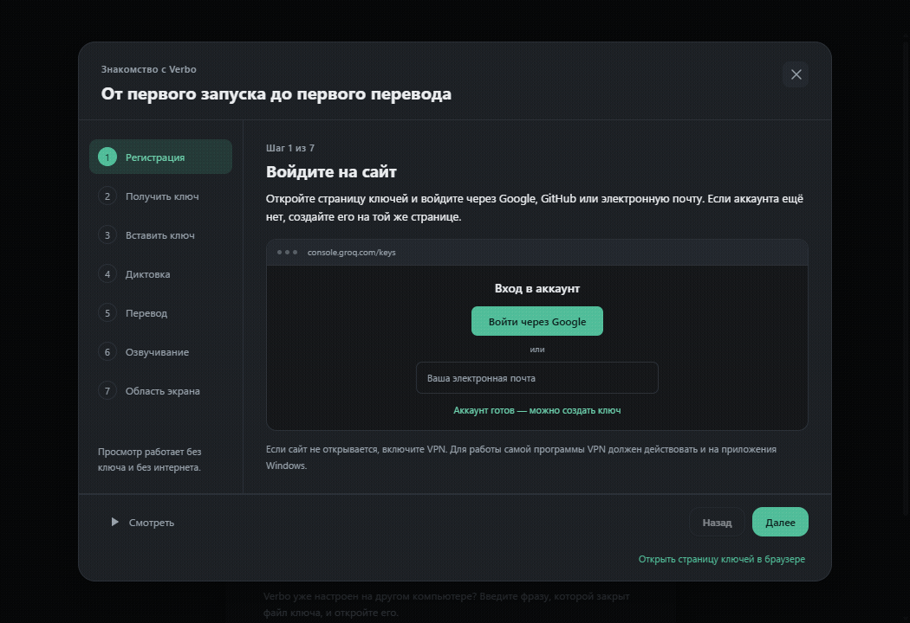

# Verbo для Оли

Переводчик с транскрипцией для Windows. Выделяешь иностранное слово или фразу —
и сразу видишь перевод и то, как это произносится: под каждым словом его
транскрипция, как в словаре.



## Что умеет

- **Перевод с транскрипцией везде:** выделенный текст в любой программе,
  кусок экрана (картинка, видео, игра, PDF), текст со скриншота и обычный ввод
  на вкладке «Переводчик».
- **Три способа записи произношения:** значками, как в школьном словаре
  `[ˈwɔːtə]`; русскими буквами, пока значки непривычны, — «уо́тэ»; или обоими
  сразу. Для китайского — пиньинь, для японского — ромадзи.
- **Послушать:** кнопка с динамиком читает вслух и оригинал, и перевод.
- **Скопировать транскрипцию** в квадратных скобках — как пишут в тетради.
- Всё остальное из Verbo: голосовой ввод в любое поле (зажми **Ctrl + Win** и говори)
  и чтение выделенного текста вслух (**Ctrl + C** дважды).



## Установка

**[Скачать последнюю версию для Windows](https://github.com/novnik25/verbo-olya/releases/latest)** —
внизу страницы, в разделе Assets, нажми файл `Verbo-Olya-Setup-<версия>.exe`.
Установщик находится в Releases, а не среди папок с исходным кодом.

1. Скачай `Verbo-Olya-Setup-<версия>.exe` в разделе
   [Releases](https://github.com/novnik25/verbo-olya/releases/latest)
   и запусти его. Права администратора не нужны.
2. Если Windows покажет синее окно «Система Windows защитила ваш компьютер» —
   нажми «Подробнее» → «Выполнить в любом случае». У программы просто нет
   платной цифровой подписи.
3. При первом запуске программа попросит **ключ доступа**. Проще всего попросить
   у брата файл ключа и фразу к нему: в окне первого запуска есть кнопка
   для файла. Или создай свой бесплатный ключ на
   [console.groq.com/keys](https://console.groq.com/keys) (карта не нужна;
   из России сайт может открываться только через VPN).

## Наглядная инструкция

При первом запуске, **до ввода ключа**, нажми **«Посмотреть, как пользоваться»** над
полем ключа. Анимированная инструкция покажет регистрацию, создание и вставку ключа,
диктовку, перевод, чтение вслух и перевод области экрана. Её можно поставить на паузу,
переключать шаги кнопками или стрелками на клавиатуре и закрыть клавишей Esc.
Для просмотра не нужны ни ключ, ни интернет. После настройки инструкция остаётся
в боковом меню — **«Как пользоваться»**.

[](https://github.com/novnik25/verbo-olya/releases/download/v1.0.2/Verbo-Olya-Guide.mp4)

**[Скачать видеоинструкцию — меньше минуты](https://github.com/novnik25/verbo-olya/releases/download/v1.0.2/Verbo-Olya-Guide.mp4)**.
Ролик с текстовыми пояснениями, без звука: его можно переслать вместе с установщиком.

## Как пользоваться

**Перевести выделенное.** Выдели слово или фразу в любой программе и быстро
нажми **Ctrl + V** два раза. Внизу экрана появится панель: сверху оригинал
с транскрипцией (кнопка с динамиком прочитает его вслух), ниже — перевод.

**Перевести кусок экрана** — когда текст нельзя выделить: в картинке, видео,
игре. Наведи мышку на полоску внизу экрана → кнопка перевода →
«Перевести область экрана» → обведи текст мышкой.

**Вкладка «Переводчик».** Напечатай текст, вставь скриншот (**Ctrl + V** прямо
в поле) или перетащи картинку — перевод и транскрипция появятся сами. Под полями
переключается способ записи: «Значками», «Русскими буквами», «Обоими способами».

**Язык перевода** меняется прямо в панели, а язык по умолчанию — в
«Настройки → Перевод». Там же транскрипцию можно выключить.

## Частые вопросы

**Можно ли поставить рядом с обычным Verbo?** Да. У версии для Оли своя папка,
свои настройки и свои ярлыки — программы друг другу не мешают. Только
сочетания клавиш у них одинаковые: если запущены обе, панели откроют обе.

**Где мои данные?** В папке `%APPDATA%\VerboOlya` — настройки, история переводов
и запомненные слова. Всё хранится только на твоём компьютере; текст для
перевода и транскрипции отправляется в сервис перевода.

**Почему транскрипция появилась не сразу?** Новые слова программа узнаёт
у сервиса — это доля секунды. Уже встречавшиеся слова она запоминает и
показывает мгновенно.

## Для разработчика

Основа — Verbo 2.4.1. Правила работы над кодом — в [CLAUDE.md](CLAUDE.md).

```powershell
npm install        # зависимости
npm run dev        # запуск в режиме разработки
npm test           # тесты
npm run dist       # установщик в dist-installer/
```
